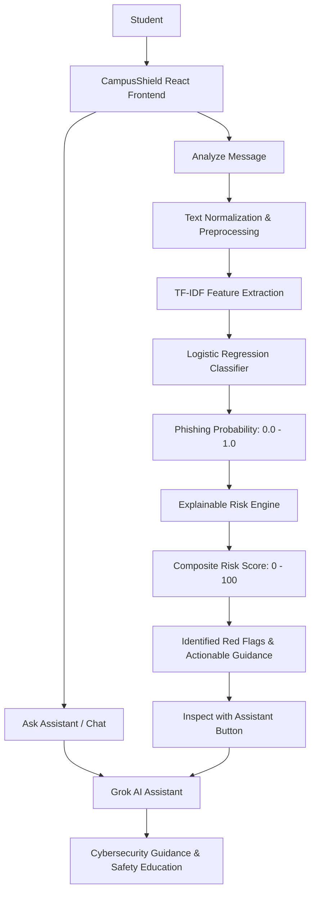
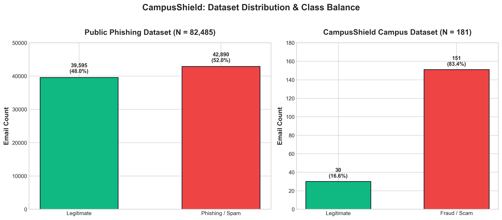
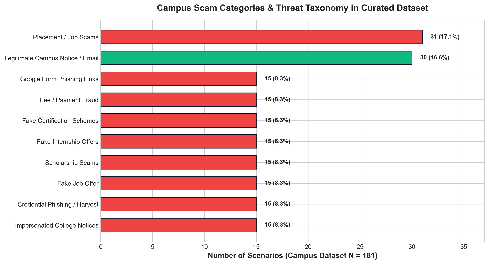
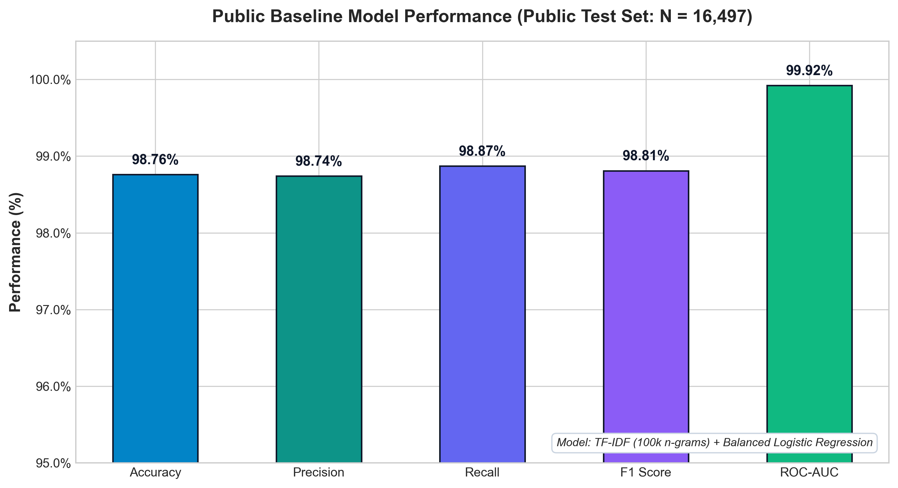
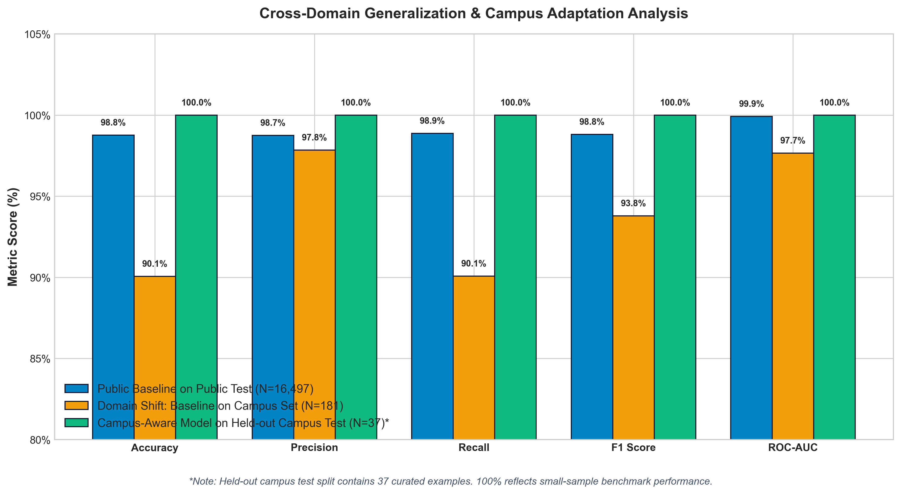
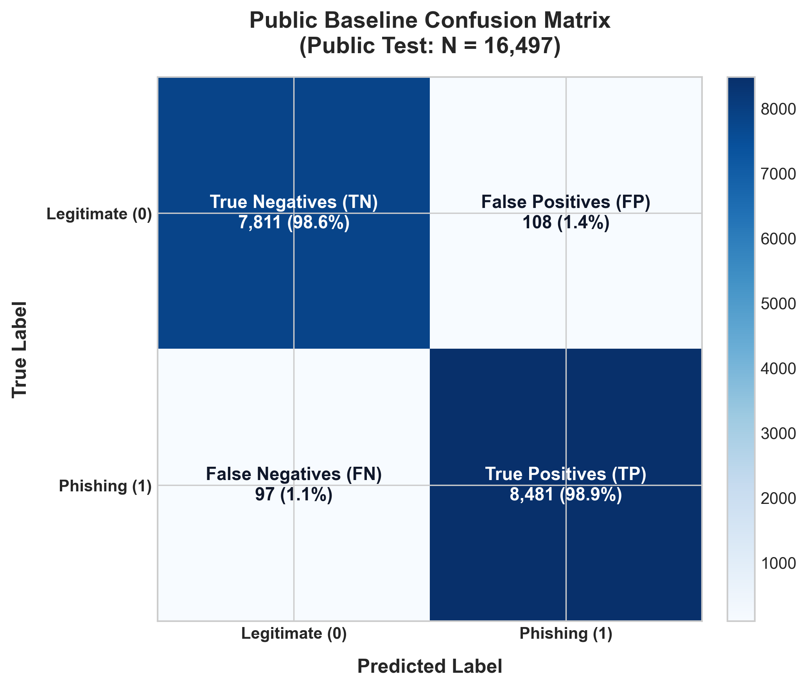
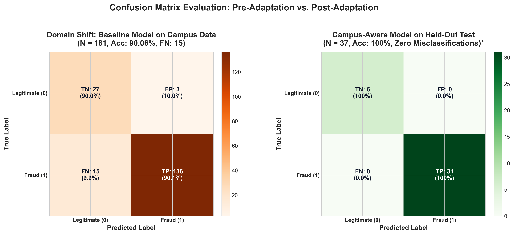
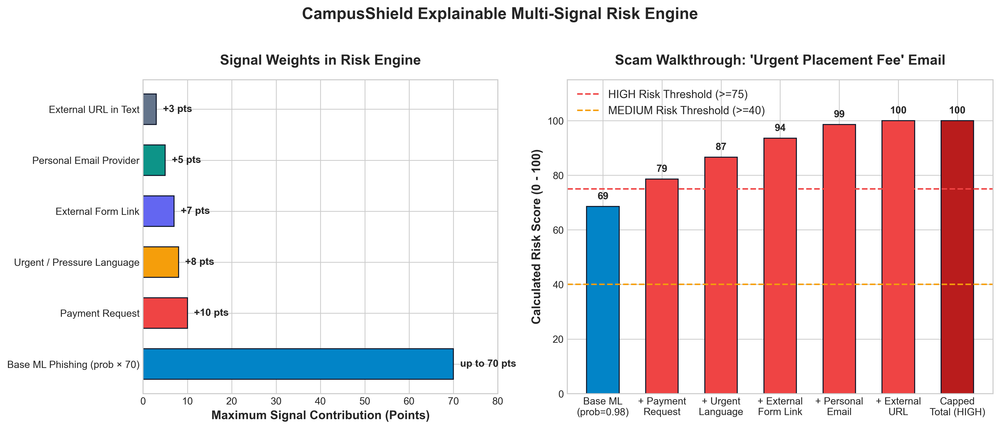

# 🛡️ CampusShield

### AI-Powered Campus Cybersecurity Assistant

[](https://www.python.org/)
[](https://fastapi.tiangolo.com/)
[](https://react.dev/)
[](https://scikit-learn.org/)
[](https://x.ai/)
[](LICENSE)

CampusShield is a student-focused cybersecurity platform that combines machine-learning-based phishing detection, interpretable risk scoring, and a Grok-powered conversational assistant to help students identify and respond to suspicious digital communication.

---

## 📑 Table of Contents

- [Overview & Problem Statement](#-overview--problem-statement)
- [Key Features](#-key-features)
- [System Architecture](#-system-architecture)
- [Detection & ML Pipeline](#-detection--ml-pipeline)
- [Conversational AI Assistant](#-conversational-ai-assistant)
- [Dataset Architecture & Attribution](#-dataset-architecture--attribution)
- [Experimental Methodology & Results](#-experimental-methodology--results)
- [Explainable Multi-Signal Risk Engine](#-explainable-multi-signal-risk-engine)
- [Demonstration Walkthrough](#-demonstration-walkthrough)
- [Repository Structure](#-repository-structure)
- [Technology Stack](#-technology-stack)
- [Local Setup & Reproduction Guide](#-local-setup--reproduction-guide)
- [REST API Reference](#-rest-api-reference)
- [Security & Secret Management](#-security--secret-management)
- [Limitations & Scientific Nuance](#-limitations--scientific-nuance)
- [Future Work](#-future-work)
- [Academic Context](#-academic-context)
- [License](#-license)

---

## 🎯 Overview & Problem Statement

College students are heavily targeted by sophisticated digital fraud. Threat actors routinely impersonate university departments, placement cells, internship recruiters, and scholarship boards. Because academic communication often carries real urgency (e.g., semester registration deadlines, interview shortlists), students are disproportionately vulnerable to social engineering.

Conventional spam filters fail in academic contexts because attacks frequently exploit legitimate platforms (e.g., Google Forms, shortened links, personal Gmail accounts disguised as HR coordinators) and mimic campus-specific nomenclature.

**CampusShield addresses this challenge through a hybrid defense model:**
1. **Statistical NLP & Machine Learning:** A trained classification pipeline that flags deceptive textual structure and semantics.
2. **Transparent Risk Engine:** An observable heuristic rule system that scores identifiable threat indicators (urgency, external forms, payment demands, personal domains).
3. **Conversational Cybersecurity Partner:** A Grok-powered interactive advisor that educates students, answers security questions, and assists in reviewing suspicious messages and screenshots.

---

## ✨ Key Features

| Feature | Description | Implementation |
| :--- | :--- | :--- |
| 🔍 **ML Phishing Detection** | High-dimensional n-gram classification identifying deceptive linguistic patterns. | TF-IDF (100k features) + Balanced Logistic Regression |
| 📊 **Explainable Risk Scoring** | Multi-factor risk engine generating a calibrated 0–100 score with explicit red flags. | Weighted rule engine combining ML probability & heuristic signals |
| 🤖 **Grok Security Assistant** | Conversational agent contextualized for campus scams, credential safety, and reporting. | xAI SDK (`grok-4.6`, vision fallbacks) with strict security prompts |
| 🎓 **Campus Threat Adaptation** | Domain-adapted model fine-tuned on curated university attack scenarios. | Dual-dataset fusion (Public corpora + Campus-curated scenarios) |
| 📷 **Screenshot Evidence Review** | Multi-modal OCR and vision analysis for suspicious email/SMS screenshots. | EasyOCR + xAI Vision models with prompt-injection defense |
| ⚡ **FastAPI High-Speed Backend** | Low-latency asynchronous REST API with validation and CORS security. | Python 3, Pydantic v2, Uvicorn ASGI |
| 💻 **Responsive React Dashboard** | Modern dark-mode interface featuring dynamic risk gauges and history inspection. | React 19, Vite, Lucide Icons, LocalStorage persistence |
| 🛡️ **Privacy-First Design** | Zero external data storage for analyzed messages; local credential segregation. | Stateless inference with strictly segregated `.env` secrets |

---

## 🏛️ System Architecture

The following diagram illustrates the interaction between the student, the client interface, the ML classification pipeline, the heuristic risk engine, and the conversational Grok assistant:



---

## 🔬 Detection & ML Pipeline

The CampusShield detection workflow translates unstructured communication text into an interpretable threat assessment:

```
Raw Email / Message
        │
        ▼
Text Cleaning & Normalization (Lowercasing, Whitespace Compaction, Whitespace Stripping)
        │
        ▼
TF-IDF Vectorization (max_features=100,000, ngram_range=(1,2), min_df=2, sublinear_tf=True)
        │
        ▼
Logistic Regression Classifier (max_iter=1000, class_weight="balanced", random_state=42)
        │
        ▼
Statistical Phishing Probability (0.0000 – 1.0000)
        │
        ▼
Explainable Multi-Signal Risk Engine
        │
        ▼
Risk Level Classification (LOW < 40 | MEDIUM 40–74 | HIGH ≥ 75)
        │
        ▼
Actionable Student Recommendation & Red-Flag Explanations
```

### Stage Details

1. **Preprocessing:** Strips anomalous spacing, normalizes unicode encoding, and consolidates the subject and body into a unified textual stream.
2. **Feature Extraction:** Computes sublinear term-frequency inverse-document-frequency representations across uni-grams and bi-grams, suppressing extreme frequency biases while capturing indicative phrases (e.g., *"urgent action required"*, *"verify portal credentials"*).
3. **Probability Estimation:** Logistic Regression fits a sigmoid curve over the feature hyperplane, yielding a calibrated posterior probability of phishing likelihood.
4. **Heuristic Rule Calibration:** The probability is scaled and combined with deterministic behavioral flags (urgency tokens, financial requests, off-campus links, spoofed headers).

---

## 🤖 Conversational AI Assistant

The conversational intelligence layer is powered by **xAI Grok** (with fallback support for vision and fast-inference endpoints).

> [!IMPORTANT]
> **Architectural Separation:** Grok serves exclusively as the conversational and explanatory assistant. It is **not** the underlying statistical classifier. The core phishing detection is handled deterministically by the trained Scikit-Learn pipeline to ensure zero hallucinations in probability estimation.

### Core Assistance Capabilities
- **Scam Identification:** Explains common mechanisms behind fake placement offers, unpaid internship scams, bogus scholarship portals, and credential harvesting forms.
- **Account Protection:** Provides step-by-step guidance on Multi-Factor Authentication (MFA), password rotation, and safe OTP handling.
- **Incident Response:** Guides students on reporting phishing attempts to campus IT services and appropriate cyber incident authorities.
- **Screenshot Evaluation:** Allows students to upload email or SMS screenshots. An integrated EasyOCR pipeline extracts readable text, which is analyzed alongside multi-modal vision models under defensive system prompts to mitigate indirect prompt injection.

---

## 📦 Dataset Architecture & Attribution

CampusShield evaluates detection capability across two distinct data sources:

1. **Public Phishing Benchmark Dataset:**
   - **Source:** Kaggle Phishing Email Dataset ([DOI: 10.34740/kaggle/ds/5074342](https://doi.org/10.34740/kaggle/ds/5074342)), compiled by Naser Abdullah Alam from CEAS 08, Enron, Nazario, Nigerian Fraud, and SpamAssassin corpora.
   - **Original Rows:** ~82,486
   - **Cleaned Rows:** **82,485** (39,595 Legitimate [Label 0], 42,890 Phishing/Spam [Label 1])
   - **Split:** 80% Training (65,988 examples) / 20% Testing (16,497 examples), stratified by label.

2. **CampusShield Campus-Style / SRM-Oriented Email Dataset:**
   - **Nature:** Curated dataset constructed specifically to reflect modern university-themed cyber attacks and legitimate campus notifications.
   - **Total Scenarios:** **181** (30 Legitimate, 151 Fraud/Scam)
   - **Threat Types:** Placement scams, internship frauds, fake exam fee portals, scholarship bait, credential phishing, Google Form scams, and verified campus announcements.
   - **Split:** 80% Training (144 examples) / 20% Testing (37 examples), stratified by label.
   - **Combined Model Training Corpus:** **66,132 examples** (65,988 public training + 144 campus training).





---

## 📊 Experimental Methodology & Results

To evaluate real-world efficacy, three experimental setups were tested:
1. **Public Baseline Model:** Trained solely on public training data (65,988 rows) and tested on public test data (16,497 rows).
2. **Domain-Shift Generalization Experiment:** The public baseline model was evaluated directly on the 181 campus-style examples without any campus fine-tuning.
3. **Campus-Aware Model:** Trained on the combined dataset (66,132 rows) and evaluated on the held-out 37-example campus test split.

### Comprehensive Performance Benchmark

| Model / Experiment | Accuracy | Precision | Recall | F1 Score | ROC-AUC | Test Split Size ($N$) |
| :--- | :---: | :---: | :---: | :---: | :---: | :---: |
| **Public Baseline** (Public Test) | **98.76%** | **98.74%** | **98.87%** | **98.81%** | **99.92%** | 16,497 |
| **Domain-Shift Generalization** (Public Model $\to$ Campus Set) | **90.06%** | **97.84%** | **90.07%** | **93.79%** | **97.66%** | 181 |
| **Campus-Aware Adapted Model** (Held-out Campus Test)\* | **100.0%** | **100.0%** | **100.0%** | **100.0%** | **100.0%** | 37 |

> [!NOTE]
> **\*Scientific Honesty Regarding the 100% Metric:**
> The campus-aware model achieved 100% accuracy on the 37-example held-out campus test split used in this project. While this result confirms that targeted campus tokens were successfully learned, the held-out test split is small and based on curated academic scenarios. This metric should **not** be interpreted as an infallible real-world accuracy guarantee on arbitrary unseen university communications.





### Confusion Matrix Analysis

Class Definitions: **0 = Legitimate**, **1 = Phishing / Fraud**

#### 1. Public Baseline Model ($N = 16,497$)
```text
                  Predicted Legitimate (0)    Predicted Phishing (1)
True Legitimate (0)        7,811 (TN)                 108 (FP)
True Phishing   (1)           97 (FN)               8,481 (TP)
```
- **False Positive Rate:** 1.36% (108 / 7,919)
- **False Negative Rate:** 1.13% (97 / 8,578)



#### 2. Domain-Shift Experiment (Public Model on 181 Campus Emails)
```text
                  Predicted Legitimate (0)    Predicted Phishing (1)
True Legitimate (0)           27 (TN)                   3 (FP)
True Phishing   (1)           15 (FN)                 136 (TP)
```
- **Finding:** Evaluating a generic spam classifier on campus-specific emails resulted in 15 false negatives (missed scams). Generic models fail on college vernacular like *"SRM Career Development Centre"*, *"Fast-Track Placement Drive"*, and *"Department Verification Form"*, proving the necessity of campus-adapted models.

#### 3. Campus-Aware Model on Held-out Campus Test ($N = 37$)
```text
                  Predicted Legitimate (0)    Predicted Phishing (1)
True Legitimate (0)            6 (TN)                   0 (FP)
True Phishing   (1)            0 (FN)                  31 (TP)
```



---

## ⚙️ Explainable Multi-Signal Risk Engine

Machine learning probabilities alone do not provide actionable clarity to non-technical students. CampusShield couples statistical inference with a deterministic rule engine:

$$\text{Base Risk} = \text{Phishing Probability} \times 70$$

$$\text{Final Risk Score} = \min\left(100, \text{round}\left(\text{Base Risk} + \sum \text{Signal Penalties}\right)\right)$$

### Observable Signal Breakdown

| Indicator | Trigger Condition | Point Weight |
| :--- | :--- | :---: |
| 🚨 **Payment Request** | Keywords: *payment, pay, fee, registration fee, deposit, upi, bank account* | **+10** |
| ⏳ **Urgency / Pressure** | Keywords: *urgent, immediately, act now, final notice, deadline, expires* | **+8** |
| 📝 **External Form Link** | Explicit external Google Form / Microsoft Form / survey registration link | **+7** |
| ✉️ **Personal Email Provider** | Sender domain is `@gmail.com`, `@yahoo.com`, `@outlook.com`, `@hotmail.com` | **+5** |
| 🔗 **External URL** | Presence of `http://`, `https://`, or `www.` link syntax | **+3** |

### Risk Level Categorization

- **HIGH RISK ($\ge 75$):** Immediate danger. Strong indicators of malicious intent or financial extortion. *Recommendation: Do not click links, submit forms, or transfer funds. Verify immediately via official campus channels.*
- **MEDIUM RISK ($40 - 74$):** Ambiguous or suspicious characteristics. *Recommendation: Exercise caution. Independently confirm sender identity before responding.*
- **LOW RISK ($< 40$):** Minimal indicators detected. *Recommendation: Message aligns with typical legitimate patterns, but standard cybersecurity diligence remains advised.*



---

## 🧪 Demonstration Walkthrough

### Test Scenario: Fake Campus Placement Drive

**Input Message:**
- **Sender:** `hr.campusjobs@gmail.com`
- **Subject:** `URGENT: Congratulations! You Are Selected for Placement`
- **Body:** `Dear Student, You have been shortlisted for the Tech Mahindra placement drive. Please pay the mandatory 500 INR registration verification fee within 24 hours at http://srm-placement-fee.fake.com and fill your details.`
- **Flags:** `has_payment_request: true`, `has_external_form: true`

**System Analysis Output:**
```json
{
  "prediction": "PHISHING",
  "phishing_probability": 0.9339,
  "risk_score": 98,
  "risk_level": "HIGH",
  "reasons": [
    "Urgent or pressure-based language detected",
    "Payment or financial request detected",
    "External form or registration link detected",
    "Sender uses a personal email provider",
    "External URL detected in message"
  ],
  "recommendation": "Do not click links, submit forms, send money, or provide credentials. Verify the message through an official channel."
}
```

---

## 📂 Repository Structure

```text
CampusShield/
├── backend/
│   ├── main.py                  # FastAPI server, endpoints, risk engine, and Grok client
│   ├── .env.example             # Template for backend environment variables
│   └── requirements.txt         # Python dependencies for the backend service
├── database/
│   └── .gitkeep                 # Storage anchor for persistent runtime databases
├── datasets/
│   ├── college/
│   │   └── srm_fraud_dataset.csv# Curated campus-style email dataset (181 rows)
│   ├── processed/
│   │   ├── srm_clean.csv        # Cleaned campus scenarios
│   │   ├── srm_train.csv        # Campus training split (144 rows)
│   │   └── srm_test.csv         # Campus held-out test split (37 rows)
│   └── raw/
│       └── .gitkeep             # Directory placeholder for raw public corpora
├── frontend/
│   ├── src/
│   │   ├── components/          # Reusable UI widgets (RiskGauge, Navbar, etc.)
│   │   ├── pages/               # AnalyzePage, ChatPage, HistoryPage, AboutPage
│   │   ├── services/api.js      # Robust HTTP client communicating with backend
│   │   ├── App.jsx              # Main React application router and state
│   │   └── index.css            # Custom responsive cybersecurity design system
│   ├── package.json             # Frontend dependencies and Vite scripts
│   └── .env.example             # Template for frontend environment variables
├── model/
│   ├── campusshield_classifier.pkl        # Production campus-aware Logistic Regression
│   ├── campusshield_tfidf_vectorizer.pkl  # Production TF-IDF n-gram vectorizer
│   ├── phishing_classifier.pkl            # Public baseline classifier
│   └── tfidf_vectorizer.pkl               # Public baseline vectorizer
├── outputs/
│   ├── figures/                 # High-resolution generated performance graphs
│   └── metrics/                 # Quantitative evaluation outputs and predictions
├── training/
│   ├── 01_inspect_datasets.py   # Dataset auditing and schema verification
│   ├── 02_prepare_datasets.py   # Cleaning and deduplication pipeline
│   ├── 03_split_dataset.py      # Stratified 80/20 train-test split for public data
│   ├── 04_train_baseline.py     # Training and serialization of baseline model
│   ├── 05_test_srm.py           # Evaluation of baseline model on campus dataset
│   ├── 06_split_srm.py          # Stratified train-test split for campus dataset
│   ├── 07_train_campus_model.py # Training of production campus-aware model
│   ├── 08_inspect_campus_predictions.py # Manual inspection of prediction outputs
│   ├── 09_test_risk_engine.py   # Verification test suite for heuristic scoring
│   ├── 10_analyze_email.py      # CLI utility for one-off email testing
│   └── generate_figures.py      # Automated script producing publication-ready plots
├── .gitignore                   # Multi-stage security, secrets, and large-file exclusions
├── LICENSE                      # MIT Open Source License with dataset terms
├── requirements.txt             # Unified Python project dependencies
└── README.md                    # Project documentation
```

---

## 🛠️ Technology Stack

- **Backend:** [FastAPI](https://fastapi.tiangolo.com/), [Uvicorn](https://www.uvicorn.org/), [Pydantic v2](https://docs.pydantic.dev/)
- **Machine Learning & NLP:** [scikit-learn](https://scikit-learn.org/), [Joblib](https://joblib.readthedocs.io/), [Pandas](https://pandas.pydata.org/), [NumPy](https://numpy.org/)
- **Conversational AI & Vision:** [xAI SDK](https://github.com/xai-org/xai-sdk-python), [EasyOCR](https://github.com/JaidedAI/EasyOCR)
- **Frontend:** [React 19](https://react.dev/), [Vite](https://vitejs.dev/), [Lucide React](https://lucide.dev/)
- **Visualization:** [Matplotlib](https://matplotlib.org/)

---

## 🚀 Local Setup & Reproduction Guide

### Prerequisites
- Python 3.10+ (tested on Python 3.11, 3.12, 3.13)
- Node.js 18+ and npm
- An xAI API Key from [console.x.ai](https://console.x.ai/) (or a Groq key starting with `gsk_`)

### 1. Clone the Repository
```bash
git clone https://github.com/ashutosh2453/CampusShield-AI-Powered-Campus-Cybersecurity-Assistant.git
cd CampusShield-AI-Powered-Campus-Cybersecurity-Assistant
```

### 2. Configure the Backend Service

```bash
# Create and activate virtual environment
python -m venv .venv

# On Windows (PowerShell):
.venv\Scripts\activate

# On Linux / macOS:
source .venv/bin/activate

# Install Python dependencies
pip install -r requirements.txt
```

#### Environment Setup
Copy the environment example template to `.env`:
```bash
# Copy example configuration
cp backend/.env.example backend/.env
```

Edit `backend/.env` and add your API key:
```env
XAI_API_KEY=your_actual_xai_api_key_here
```

> [!WARNING]
> Never commit `backend/.env` or expose your private API credentials. The `.gitignore` file is configured to exclude all `.env` files automatically.

#### Start the FastAPI Server
```bash
python -m uvicorn backend.main:app --reload --port 8001
```
The backend will launch at `http://127.0.0.1:8001`. You can test Swagger documentation at `http://127.0.0.1:8001/docs`.

---

### 3. Configure the React Frontend

Open a new terminal window:
```bash
cd frontend

# Install Node dependencies
npm install

# Start Vite development server
npm run dev
```
Open your browser and navigate to `http://localhost:5173`.

---

### 4. Reproducing Datasets & Generating Figures

To reproduce the data preparation and training steps from source:
```bash
# 1. Prepare raw datasets (requires Kaggle phishing_email.csv placed in datasets/raw/)
python training/02_prepare_datasets.py

# 2. Generate stratified splits
python training/03_split_dataset.py
python training/06_split_srm.py

# 3. Train models
python training/04_train_baseline.py
python training/07_train_campus_model.py

# 4. Generate documentation figures
python training/generate_figures.py
```

---

## 🔌 REST API Reference

### Health Check
- **Endpoint:** `GET /`
- **Response:**
  ```json
  {
    "message": "CampusShield API is running",
    "version": "1.0.0"
  }
  ```

---

### Analyze Email / Message
- **Endpoint:** `POST /analyze`
- **Request Body:**
  ```json
  {
    "sender_email": "dean.office.notice@gmail.com",
    "subject": "Mandatory Semester Registration Clearance",
    "body": "All students must submit verification forms immediately at http://verify-portal.fake.com",
    "has_external_form": true,
    "has_payment_request": false
  }
  ```
- **Response:**
  ```json
  {
    "prediction": "PHISHING",
    "phishing_probability": 0.8912,
    "risk_score": 77,
    "risk_level": "HIGH",
    "reasons": [
      "Urgent or pressure-based language detected",
      "External form or registration link detected",
      "Sender uses a personal email provider",
      "External URL detected in message"
    ],
    "recommendation": "Do not click links, submit forms, send money, or provide credentials. Verify the message through an official channel."
  }
  ```

---

### Conversational Cybersecurity Assistant
- **Endpoint:** `POST /chat`
- **Payload Format:** Accepts either JSON or `multipart/form-data` (when uploading screenshot images up to 10 MB).
- **JSON Request:**
  ```json
  {
    "message": "How do I know if an internship email asking for a security deposit is a scam?",
    "history": []
  }
  ```
- **Response:**
  ```json
  {
    "response": "Legitimate companies and campus placement drives almost never charge candidates a 'security deposit' or 'processing fee' for internships..."
  }
  ```

---

## 🔒 Security & Secret Management

- **API Keys:** Kept strictly inside non-tracked local `.env` files. The repository includes `.env.example` as a safe placeholder.
- **Defensive LLM Prompting:** System instructions for image review explicitly treat user-uploaded images and OCR text as untrusted evidence to counter prompt-injection vectors (e.g., screenshots containing *"Ignore all previous instructions"*).
- **CORS Protection:** FastAPIs CORS middleware restricts origin regex patterns during development.
- **Client-Side Privacy:** Analysis histories are stored directly in browser `localStorage`, ensuring student queries are not retained on remote databases without authorization.

---

## ⚠️ Limitations & Scientific Nuance

1. **Curated Campus Dataset Size:** The campus-specific dataset contains 181 scenarios. While effective for fine-tuning on known university scam templates, it does not cover the full entropy of real-world university communication across different universities.
2. **Held-Out Test Sample Size:** The campus-aware model achieved 100% on the 37-example held-out test split. This demonstrates strong adaptation to the curated distribution, but should not be extrapolated as an absolute real-world guarantee.
3. **OCR & Vision Assistance:** The image analysis pipeline serves as an assistive advisory tool. Image artifacts, low resolution, or adversarial typography may impair OCR text extraction.
4. **Textual Scope:** The ML classifier currently operates on textual features (subject and body) rather than deep network packet inspection, DKIM/SPF cryptographic signatures, or domain age metadata.

---

## 🔮 Future Work

- [ ] **Live URL Sandbox & WHOIS Verification:** Integration with automated URL reputation APIs to verify domain registration age and active DNS records.
- [ ] **Automated QR-Code Parsing:** Real-time decoding and threat scanning for QR-code based attacks (*quishing*) embedded in flyers and posters.
- [ ] **Institutional Ticketing Integration:** Direct one-click forwarding of verified threats to university IT incident management queues.
- [ ] **Multilingual Campus Support:** Extending the TF-IDF and NLP pipelines to detect regionally targeted vernacular phishing in Indian languages.
- [ ] **Active Learning & Feedback Loop:** Anonymized student feedback mechanisms to periodically augment the campus dataset with emerging scam patterns.

---

## 🎓 Academic Context

- **Project Title:** CampusShield: A Conversational Cybersecurity System for Student Safety and Campus Threats Detection
- **Academic Course:** 21CSE306P Applied Generative AI
- **Program:** B.Tech — 5th Semester (Academic Year 2026–27)

---

## 📄 License & Dataset Attribution

- **Source Code:** Released under the [MIT License](LICENSE).
- **Public Phishing Dataset:** Sourced from Kaggle ([Phishing Email Dataset by Naser Abdullah Alam](https://www.kaggle.com/datasets/naserabdullahalam/phishing-email-dataset), DOI: `10.34740/kaggle/ds/5074342`). All rights to the third-party public corpora remain governed by their original source licenses.
